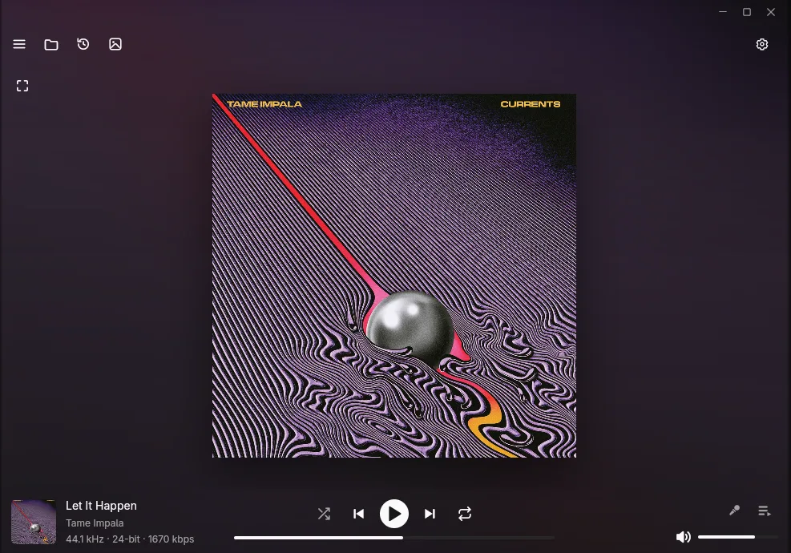
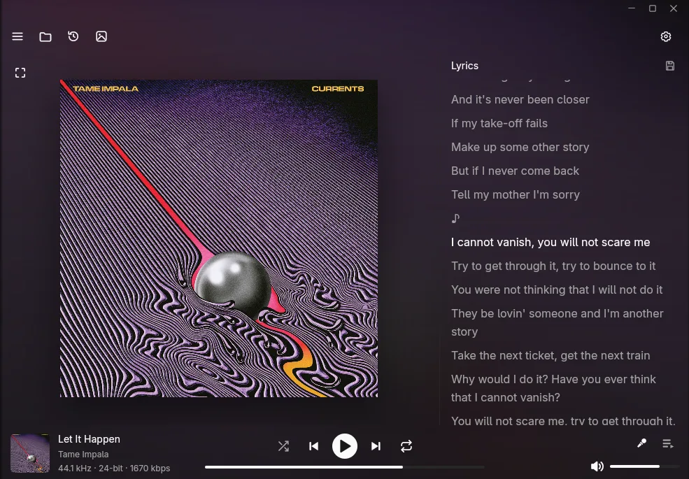
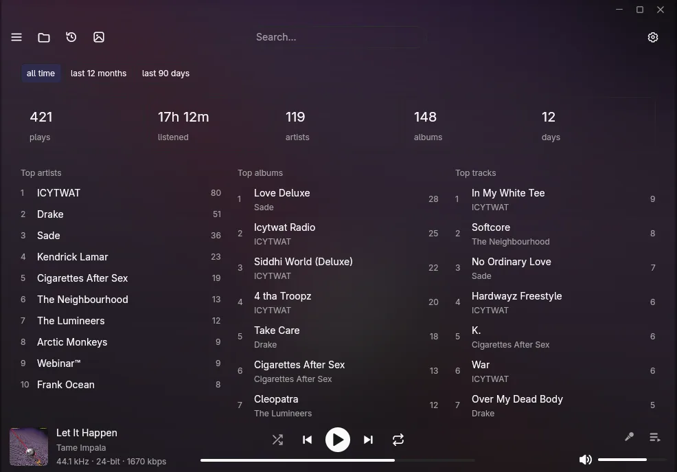
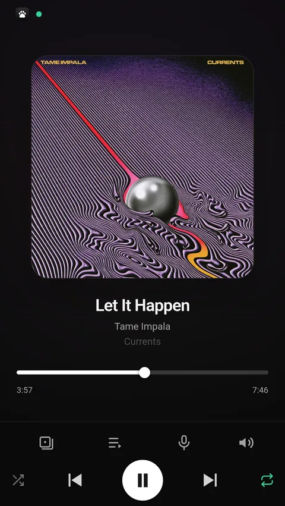

<div align="center">

# 🎧 Pulse

**A personal, local-first music player for Linux.**

One library. No account. No cloud.

</div>

---

<div align="center">
  
</div>

## What it does

**Library** — indexes the folders you choose and keeps watching them. Browse by
album, artist, folder, playlist or one flat All tracks list; `Ctrl+K` searches
everything; shift- and ctrl-click select rows across a list. Cue sheets are
understood, and a re-rip or a moved folder doesn't lose your play history.

**Playback** — native sample rate through PipeWire, or an exclusive grab if you
prefer. ReplayGain (per track or per album, with clipping protection) read from
the tags your files already carry. A real play-next queue, shuffle and repeat,
and a full-screen cover view.

**Editing** — a tag editor for one track or a whole album, including cover art
and raw tag rows, followed by a rescan of exactly what changed. Lyrics from
embedded tags, `.lrc` sidecars or LRCLIB, with a button to save what you fetched.

<div align="center">
  
</div>

**Rewind** — what you actually listened to: plays, hours, artists, albums and
tracks over the last 90 days, all counted from your own history rather than a
service.

<div align="center">
  
</div>

**Housekeeping** — a duplicate finder that keeps one copy of each song by folder
priority and trashes the rest, daily rotated database backups with one-click
restore, an integrity report, and a portable export that carries its own data.

**Discord Rich Presence** — your profile shows what is playing: title, artist,
album as the cover's tooltip, cover art looked up per album and cached, and a
timer that knows where you are in the track. Every one of those is a switch, so
the activity can be as quiet or as detailed as you like, and it can either clear
when you pause or stay up marked as paused. It needs a Discord application ID at
build time — see [Discord Rich Presence](#discord-rich-presence).

**Phone remote** — the same library on your phone. See [Phone remote](#phone-remote).

## Phone remote

An optional web UI, compiled into the binary: no separate server, no second
database, nothing to keep in sync. It is a Svelte app served by the player
itself, so it speaks to the same queue and the same library the desktop is
using, and the state arrives over a socket rather than a polling loop.

<div align="center">
  
</div>

Turn it on in **Settings → Online → Remote control**, then open the address that
page shows:

| Where the phone is | Address |
|---|---|
| same Wi-Fi | the LAN address — `http://192.168.1.20:8770` |
| anywhere, with Tailscale on the phone | the tailnet address — `http://100.64.0.5:8770` |

The second line only appears when Tailscale is up on the desktop, because it is
read from the tunnel interface rather than guessed — a machine without it shows
one address, not two.

Typing an address on a phone is the annoying part, so the same page can show a
**QR code** for the camera (on by default, one switch to hide it). It encodes
the tailnet address when there is one, so a scan keeps working when you leave
the house.

What the phone gets:

- **Transport in the bottom dock**, inside thumb reach, with library, queue and
  volume in the row above it. The volume control can be the popover over the
  artwork or a **slider in the dock** — a setting on the desktop, since it is a
  preference about the phone, not the player.
- **Swipes** — left/right on the artwork is next/previous, a queue row swiped
  left is gone, swipe down to close a sheet.
- **Long press** any track for play now / play next / queue / go to artist / go
  to album.
- **The whole library** — albums, artists, playlists, folders and the flat
  catalog, with search across all of them, plus a **Recent** tab of what was
  played last.
- **A queue you can edit** — drag rows to reorder, clear it, or drop one.
- **Lyrics that follow along**, with the sung line highlighted and tap-to-seek,
  and a button to fetch them when a track has none. The screen is held awake
  while they are open, so it does not dim mid-song.

### Access token

Off by default: on a home network the remote is open to anything on it. Turn on
**Access token** and every request needs it — the page, the covers, the socket,
the commands. The QR code carries it, so scanning still just works: the phone is
let in once and handed a cookie, and the token is stripped from the address bar
on the way so it does not end up in history. Generate or remove it from the same
row; changing it restarts the server, which drops every connected phone.

It is a bearer credential — anyone holding it has the same control as the person
at the keyboard — so treat the link like a password.

### Add to home screen

Browsers only offer a real install from a secure origin. Tailscale will put
HTTPS in front of the port with a certificate you don't have to trust by hand:

```sh
tailscale serve --bg 8770
```

Open `https://<machine>.<your-tailnet>.ts.net` on the phone and add it to the
home screen — it then runs without browser chrome. Over plain HTTP the UI still
works, it just stays a tab.

### What it is not

There is **no account system**: one token, shared by every device, or nothing at
all. The server trusts the network it is on, which is why it is off by default
and why the address it advertises is your LAN or your tailnet. Do not
port-forward it to the internet.

## Discord Rich Presence

Off until you turn it on, and then as detailed or as quiet as you want. The
activity is built from your library, not from a service:

| Setting | Default |
|---|---|
| Title on the activity | on |
| Artist | on |
| Album, as the cover's tooltip | on |
| Cover art | off — one lookup per album, then cached |
| Time remaining | on |
| Stay up when paused | off — otherwise the activity clears |

The cover has to come from a URL, because Discord cannot display an image that
only exists on your disk; that is the one reason the app makes a network request
here, which is why it is off by default. The artwork comes from iTunes, with
MusicBrainz as a fallback, and a result is only used when its artist and album
match your tags — a search for an album title also returns compilations and
deluxe editions, so the first hit is not good enough. If nothing matches, that
album simply has no cover rather than the wrong one.

Rich Presence needs an application id, which Discord issues per app and which
has to be compiled in:

1. Create an application at [discord.com/developers](https://discord.com/developers/applications) — the name is what friends see, so call it Pulse.
2. Copy its **Application ID**.
3. Put `DISCORD_CLIENT_ID=<the id>` in a `.env` file at the repository root.
4. Rebuild. A build without it hides the switches and says so on the page.

Nothing else is uploaded: Discord only receives the strings it displays.

## Offline by default

Nothing touches the network unless you ask. Everything online lives on one
**Settings → Online** page and starts off:

| | Default |
|---|---|
| Lyrics from the internet (LRCLIB) | off |
| Discord Rich Presence | off |
| Remote control web server | off |

No accounts, no analytics, no telemetry, no scrobbling.

## Requirements

- Linux with **PipeWire** and `pipewire-alsa`
- `alsa-lib`, `libxkbcommon`, `libxcb` at runtime
- A Rust toolchain to build from source

## Install

Prebuilt, from [Releases](../../releases):

```sh
tar -xzf pulse-*-x86_64-linux.tar.gz
install -m 755 pulse ~/.local/bin/pulse
```

From source:

```sh
cargo build --release -p pulse
install -m 755 target/release/pulse ~/.local/bin/pulse
```

The remote UI in `web/` is compiled into the binary, so build it before a
release build or the binary ships without it (a debug build never embeds it):

```sh
cd web && npm install && npm run build
```

## Keyboard

| Key | Action |
|---|---|
| `Ctrl+K` | command palette |
| `Space` | play / pause |
| `←` `→` | seek |
| `Ctrl+←` `Ctrl+→` | previous / next track |
| `↑` `↓` | volume |
| `Q` | queue the hovered track to play next |
| `Esc` | leave the cover view |

## Where things live

| | Path |
|---|---|
| Settings | `~/.config/pulse-music/settings.json` |
| Library database | `~/.local/share/pulse-music/library.db` |
| Backups | `~/.local/share/pulse-music/backups/` |
| Logs | `~/.local/share/pulse-music/logs/` |
| Covers and artwork | `~/.cache/pulse-music/` |

The directory is `pulse-music`, never `~/.config/pulse` — that one belongs to
PipeWire-Pulse. Set **`PULSE_HOME`** to move all of it into one directory, which
is what makes an exported copy independent of the machine it came from.

## Development

```sh
make generate              # audio fixtures, once (needs ffmpeg)
cargo test --workspace     # ~1,000 tests
cargo clippy --workspace --all-targets
```

```
crates/
  pulse/            the application (produces the `pulse` binary)
  pulse_remote/     remote control server + embedded web UI
  music_library/    SQLite schema, queries, identity and adoption
  music_indexer/    scanning, tag parsing, cue sheets
  tag_writer/       metadata writing
  audio_*/          decoder, engine, PipeWire/ALSA output
  lyrics/           local and LRCLIB lyrics
  discord/          Rich Presence
web/                the remote UI (Svelte)
```

Every crate has a `doc.md` beside its source: what it does, why, and which parts
look wrong but are load-bearing.

## License

MIT — see [`LICENSE`](LICENSE).

Pulse is built on [Pawse](https://github.com/popovpsk/pawse) by Aleksandr Popov.
