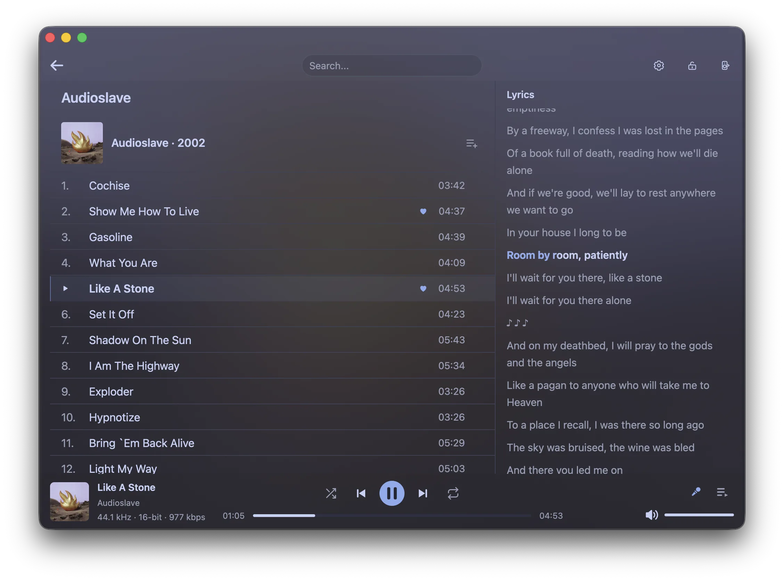
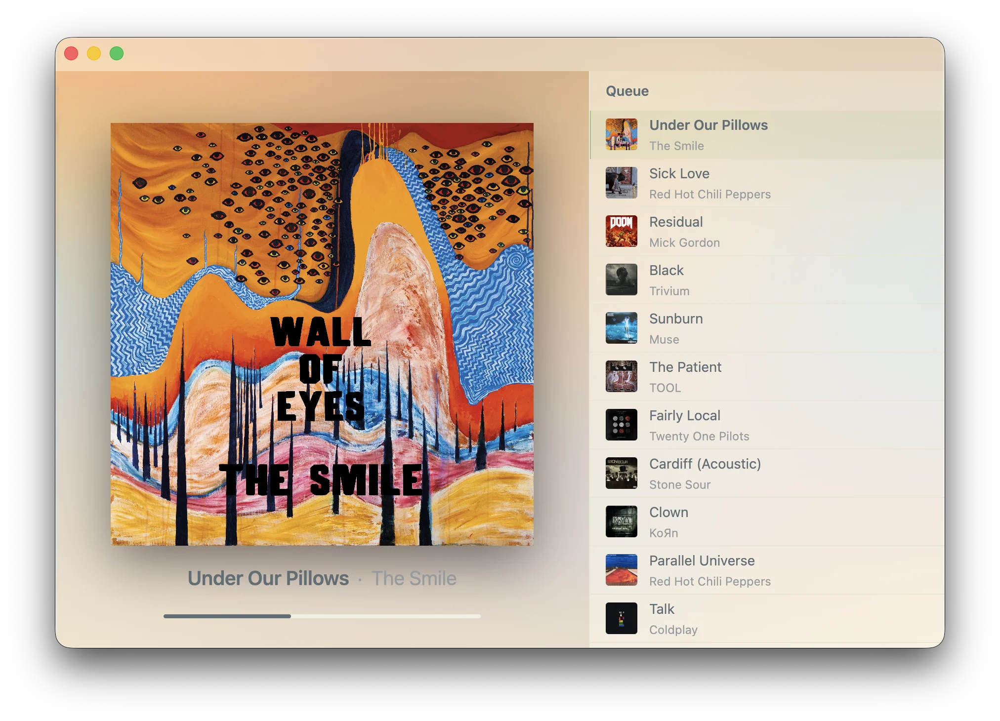
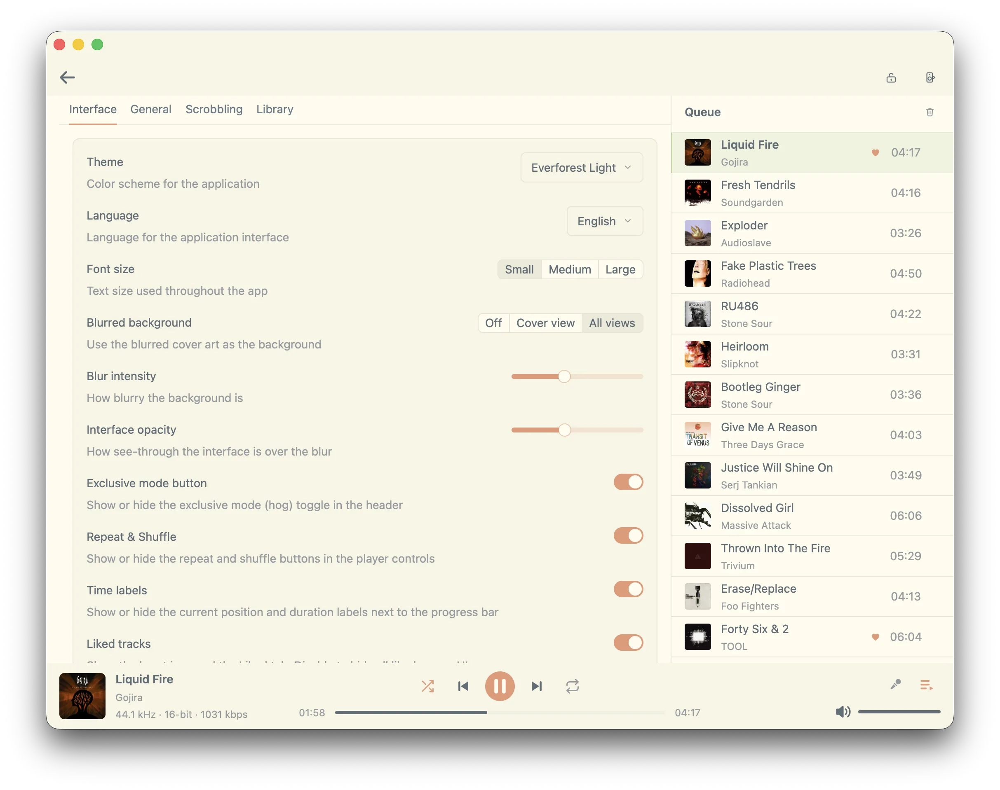
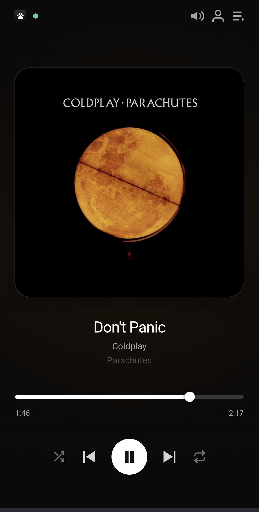

# Pulse

A personal, local-first music player for Linux — one library, one listener, no
account, no cloud.

It runs as a single native window, indexes the music you already own, and does
its best to stay out of the way while it plays.

---

## Screenshots

<p align="center">
  
  
</p>

<p align="center">
  
  
</p>

## What it does

**Library**
- Indexes folders you choose, and keeps watching them: add a file and the
  library catches up on its own.
- Browses by **album**, **artist**, **genre**, **folder**, **playlist**, and one
  flat **All Tracks** list.
- Cue-sheet aware, with a small adoption layer so a re-rip or a moved folder
  doesn't duplicate your play history.
- **Ctrl+K** opens a command palette over tracks, albums, artists, genres and
  playlists.

**Playback**
- Native sample rate through PipeWire, exclusively if you want it.
- A real **play-next queue**: queue something and it plays next; queue more and
  they follow in the order you queued them.
- Shuffle and repeat, an always-available **cover view**, and a now-playing bar
  that stays honest about what is actually playing.

**Editing**
- **Tag editor** for a single track or a whole album, with cover art and raw tag
  rows, followed by a rescan of what changed.
- Lyrics: read embedded, `.lrc` sidecars, or fetched from LRCLIB on request —
  and save what you fetched as a `.lrc` beside the track with one button.

**Everything else**
- **Rewind** — listening totals and your top artists, albums and tracks, over
  all time or a rolling window.
- **Data safety** — a daily rotated database backup, one-click restore, and an
  integrity report that counts broken rows without deleting anything.
- **Portable export** — copy the program and, optionally, your settings and
  library into a folder that keeps its own data and runs anywhere.

## Offline by default

Nothing touches the network unless you ask it to. Everything that needs the
internet lives on one **Settings → Online** page and starts off:

| Feature | Default |
|---|---|
| Lyrics from the internet (LRCLIB) | off |
| Discord Rich Presence | off |
| Remote control web server | off |

No accounts, no analytics, no crash reporting, no scrobbling.

## Requirements

- Linux, with PipeWire and `pipewire-alsa` running.
- A Rust toolchain (stable).
- The usual native build dependencies for a GPUI app on an Arch-based system.

## Build and install

```sh
cargo build --release -p pawse
install -m 755 target/release/pulse ~/.local/bin/pulse
```

The crate is `pawse`; the binary it produces is `pulse`. That split is
deliberate and is not going to be "fixed".

The remote control UI in `web/` is a Svelte app embedded into the binary at
build time — rebuild it after changing anything there:

```sh
cd web && npm install && npm run build
```

## Where things live

| What | Path |
|---|---|
| Settings | `~/.config/pulse-music/settings.json` |
| Library database | `~/.local/share/pulse-music/library.db` |
| Backups | `~/.local/share/pulse-music/backups/` |
| Logs | `~/.local/share/pulse-music/logs/` |
| Cache (covers, artwork) | `~/.cache/pulse-music/` |

The directory is `pulse-music` — never `~/.config/pulse`, which belongs to
PipeWire-Pulse.

Set **`PULSE_HOME`** to point all of the above at a single directory instead.
That is what makes an exported copy independent of the machine it came from.

## Keyboard

| Key | Action |
|---|---|
| `Ctrl+K` | command palette |
| `Space` | play / pause |
| `←` `→` | seek |
| `Ctrl+←` `Ctrl+→` | previous / next track |
| `↑` `↓` | volume |
| `Q` | queue the hovered track to play next |
| `Esc` | leave the cover view |

## Layout

```
crates/
  pawse/            the application (binary name: pulse)
  pawse_remote/     remote control server + embedded web UI
  music_library/    SQLite schema, queries, identity/adoption
  music_indexer/    scanning, tag parsing, cue sheets
  audio_*/          playback engine, decoders, PipeWire/ALSA output
  lyrics/           local and LRCLIB lyrics
  tag_writer/       metadata writing
  discord/          Rich Presence
web/                the remote UI (Svelte)
```

Each crate has a `doc.md` next to its source with the design notes: what it does,
why it does it that way, and the parts that look wrong but are load-bearing.

## Development

```sh
cargo test --workspace     # ~955 tests
cargo clippy --workspace --all-targets
```

A release build takes a few minutes; an incremental no-op build is under a
second.

## Notes

- Crate and package names are still `pawse` / `pawse_remote`; only the product,
  the binary and the on-disk paths were renamed.
- Track rows written by an older build may carry a `pawse-source://` locator.
  It is recognised and treated as "no local file" rather than handed to the
  decoder.
- The database keeps a few tables from removed features as inert history. They
  are never read or written, and no migration drops them, so an existing
  library cannot lose data on upgrade.
- Motion is optional by design: every animation has its own switch, and there is
  a master switch. Turned off, the app is exactly as usable, just still.

## License

MIT — see [`LICENSE`](LICENSE).

Pulse is built on [Pawse](https://github.com/popovpsk/pawse) by Aleksandr Popov.
