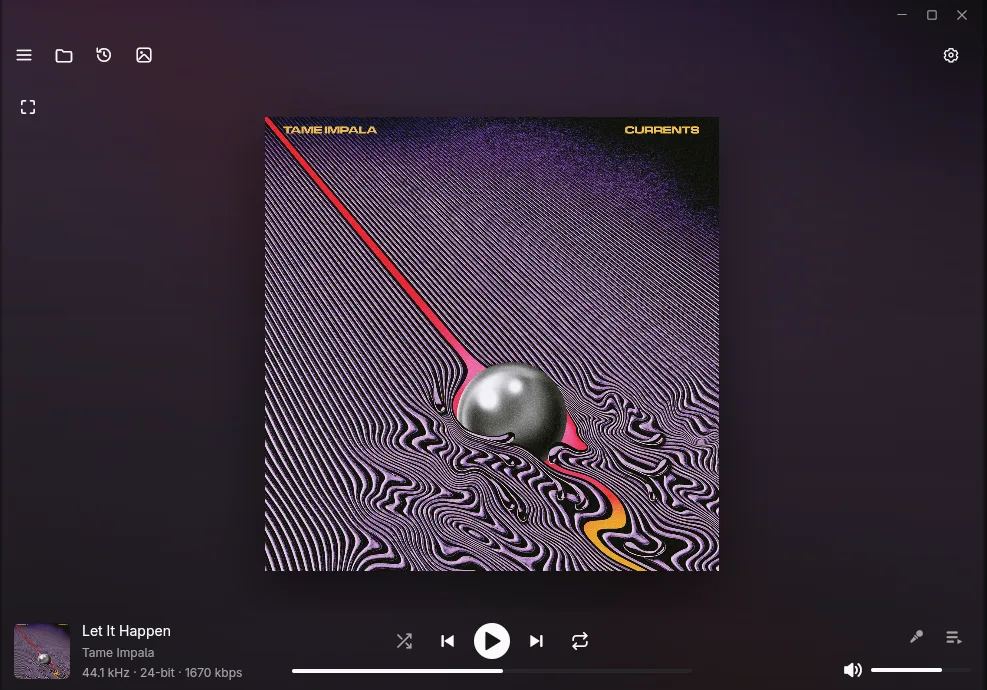

<div align="center">

# 🎧 Pulse

**A local-first music player for Linux.**

One library. No account. No cloud.



</div>

## Features

- **Library** — watches the folders you choose. Browse albums, artists, folders,
  playlists or all tracks. `Ctrl+K` searches everything. Cue sheets supported.
- **Playback** — native sample rate through PipeWire, or exclusive mode.
  ReplayGain, gapless playback, queue, shuffle, repeat and a full-screen cover
  view.
- **Editing** — tag editor for a track or a whole album, cover art included.
  Lyrics from tags, `.lrc` files or LRCLIB.
- **Rewind** — plays, hours and top artists, albums and tracks for the last 90
  days, counted from your own history.
- **Housekeeping** — duplicate finder by folder priority, rotated database
  backups, integrity report and portable export.
- **Get music** — search Amazon Music, Qobuz, Tidal and friends through
  lucida.to without leaving the app, then let the library pick the download up
  on its own. `Ctrl+Shift+G`.

## Offline by default

Nothing touches the network unless you ask. Everything online starts off:

| Feature | Default |
|---|---|
| Lyrics from the internet (LRCLIB) | off |
| Discord Rich Presence | off |
| Remote control web server | off |

No accounts, analytics, telemetry or scrobbling. Updates are checked only when
you press **Settings → General → Check for updates**, and the download is
verified against the release's SHA-256 before it replaces the running binary.

**Get music** is a handoff, not a downloader. Pulse builds the lucida.to page
for your search and opens it in your browser; it never contacts lucida itself,
never scrapes it, and keeps no record of what you looked for. Add a download
folder in **Settings → Online** and whatever lands in it is indexed a few
seconds later.

## Install

From [Releases](../../releases):

```sh
tar -xzf pulse-*-x86_64-linux.tar.gz
install -m 755 pulse ~/.local/bin/pulse
```

From source:

```sh
cargo build --release -p pulse
install -m 755 target/release/pulse ~/.local/bin/pulse
```

The phone UI in `web/` is compiled into the binary, so build it first:

```sh
cd web && npm install && npm run build
```

## Requirements

- Linux with **PipeWire** and `pipewire-alsa`
- `alsa-lib`, `libxkbcommon`, `libxcb`
- Rust toolchain, to build from source

## Phone remote

An optional web UI, served by the player itself — same queue, same library, no
second server. Turn it on in **Settings → Online → Remote control** and open the
address it shows. Add `tailscale serve --bg 8770` if you want HTTPS and a home
screen icon. Off by default, with an optional access token.

## Keyboard

| Key | Action |
|---|---|
| `Ctrl+K` | command palette |
| `Space` | play / pause |
| `←` `→` | seek |
| `Ctrl+←` `Ctrl+→` | previous / next track |
| `↑` `↓` | volume |
| `Q` | queue the hovered track to play next |
| `Esc` | leave the cover view |

## Where things live

| | Path |
|---|---|
| Settings | `~/.config/pulse-music/settings.json` |
| Library database | `~/.local/share/pulse-music/library.db` |
| Backups | `~/.local/share/pulse-music/backups/` |
| Logs | `~/.local/share/pulse-music/logs/` |
| Covers | `~/.cache/pulse-music/` |

Set `PULSE_HOME` to move everything into one directory, which makes an exported
copy independent of the machine it came from.

## Development

```sh
make generate              # audio fixtures, once (needs ffmpeg)
cargo test --workspace
cargo clippy --workspace --all-targets
```

```
crates/          the player, library, indexer, audio, tag writer and friends
web/             the phone UI (Svelte)
```

Every crate has a `doc.md` beside its source.

## License

MIT — see [`LICENSE`](LICENSE).

Built on [Pawse](https://github.com/popovpsk/pawse) by Aleksandr Popov.
